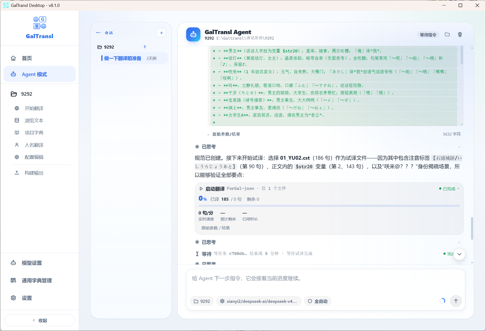

<div align=center></div>

<h1><p align='center' >GalTransl</p></h1>
<div align=center>      </div>
<p align='center' >Visual Novel Automatic Translation Solution Supporting GPT/Claude/Deepseek/Sakura and Other LLMs</p>

  [中文](https://github.com/XD2333/GalTransl/blob/main/README.md)

  GalTransl is an automatic visual novel translation tool that combines several improvements to basic functions with deep use of GPT prompt engineering to create embedded translation patches. It now provides a **desktop graphical interface**, so the full translation workflow can be completed without the command line.

> [!TIP]
> **Want to translate a visual novel but don't know how to extract the script text or put the translation back into the game?**
>
> Use the **"Extraction Agent"** in the desktop app: create a new extraction and select the game directory. The AI identifies the engine, extracts the script text, and after translation writes GalTransl's results back into a game patch. Test a few lines of Chinese first before translating the whole game; actual support depends on the engine and game version.

## 🤖 Agent Mode Is Now Available

> [!IMPORTANT]
> **GalTransl now supports Agent mode, which can carry out the entire translation workflow on its own.**
>
> Enter **Agent mode** in the desktop app and describe your translation needs in natural language; the Agent then drives the translation task by itself.




## Preface
&ensp;&ensp;&ensp;&ensp;The core of GalTransl is a set of automatic translation pipelines that solves most of the known problems in automatically translating visual novels with ChatGPT and improves overall translation quality. By combining it with other projects, the whole patch-making process is connected, which lowers the entry barrier to some degree. If you are interested, this project makes it easier to build machine-translated patches of reasonable quality, and you can (perhaps) build higher-quality translation patches efficiently on top of this framework.

  * Features:
  1. 🖥️ **Desktop GUI** — a modern desktop app built with Tauri + React, no command line needed. Supports dark mode, custom backgrounds, multi-project management, and more


  2. Supports **GPT/Claude/Deepseek/Sakura** and other LLMs, with GPT translation quality improved through prompt engineering
  3. Supports the **GPT dictionary**, which lets GPT understand character settings and accurately translate names, pronouns, and new words
  4. A flexible automatic dictionary system with pre-translation, post-translation, and conditional dictionaries
  5. Real-time cache saving and automatic resume from breakpoints
  6. Combined with other projects, supports one-click unpacking and injection of scripts for many engines, with a complete tutorial to lower the learning curve
  7. Directly translates srt, lrc, and vtt subtitle files, mtool json files, t++ excel files, and epub files
  8. 🤗 [GalTransl-7B-v3.5](https://huggingface.co/SakuraLLM/GalTransl-7B-v2) is a local model specifically optimized for visual novel translation, deployable on GPUs with 6 GB+ VRAM, built jointly by sakuraumi and xd2333
  9. 🤗 [GalTransl-14B-v3](https://huggingface.co/SakuraLLM/Sakura-GalTransl-14B-v3) is the 14B version of the GalTransl-v3 model. Thanks to a larger base model and improved alignment training, GalTransl-14B-v3 has better overall quality than GalTransl-7B-v3

<b>❗❗When publishing translations made with this tool without full proofreading/polishing, please clearly label them as "xx model AI translation patch", not as a "personal translation" patch.</b>

## Recent Updates
* 2026.8: Updated v8, added Agent mode, where AI carries out the translation workflow on its own
* 2026.4: Updated v7, added the **desktop GUI** (Tauri + React) with dark mode, custom backgrounds, multi-project management, a visual translation workflow, etc.
* 2025.5: Updated v6, added the ForGal translation template and the GalTransl-14B-v3 model
* 2024.5: Updated v5, added the GalTransl-7B model and support for many file types
* 2024.2: Updated v4, mainly added the plugin system
* 2023.12: Updated v3, file-based multithreading by @ryank231231
* 2023.7: Updated v2, major code refactoring by @ryank231231
* 2023.6: v1 initial release

## Navigation
* [Environment Preparation](https://github.com/XD2333/GalTransl/blob/main/README_EN.md#environment-preparation): installing the environment and software
* [Getting Started Tutorial](https://github.com/XD2333/GalTransl/blob/main/README_EN.md#getting-started-tutorial): a full walkthrough of making a machine-translated patch. **If you only want to know how to use this tool, jump straight to section 2.2 of Part 2**
* [Configuration and Engine Settings](https://github.com/XD2333/GalTransl/blob/main/README_EN.md#configuration-and-engine-settings): details on calling and configuring each translation engine API
* [GalTransl Core Features](https://github.com/XD2333/GalTransl/blob/main/README_EN.md#galtransl-core-features): the GPT dictionary, cache, ordinary dictionaries, problem finding, and more
* Further tutorials have been [moved to the Wiki](https://github.com/xd2333/GalTransl/wiki)
* [Development and Builds](#development-and-builds): development environment, running from source, platform builds, and automated releases (click to expand)

## Environment Preparation
  * **Desktop Version (Recommended)**
  Download the desktop package for your platform from [Releases](https://github.com/GalTransl/GalTransl/releases/). On Windows, use `GalTransl_*_win.zip`: extract it and double-click `GalTransl Desktop.exe`; **Python is not required**. Linux x86_64 uses a portable `.tar.gz`: extract it and run `./galtransl-desktop`; the system still needs runtime libraries such as WebKitGTK 4.1. macOS releases include separate Intel and Apple Silicon DMGs plus portable `.tar.gz` archives. The desktop app automatically starts a separate backend for each instance on a free port; closing one window stops only its own backend, and other windows keep running.


## Practical Tools
| Name | Description |
| --- | --- |
| GARbro | Engine tool: a godlike unpacker. [Download](https://github.com/morkt/GARbro/releases/download/v1.5.44/GARbro-v1.5.44.2904.rar) |
| [KirikiriTools](https://github.com/arcusmaximus/KirikiriTools) | Engine tool: Krkr, krkrz extraction and injection tool |
| [UniversalInjectorFramework](https://github.com/AtomCrafty/UniversalInjectorFramework) | Engine tool: universal injection framework for Shift-JIS tunnel and Shift-JIS replacement modes |
| [VNTextProxy](https://github.com/arcusmaximus/VNTranslationTools) | Engine tool: universal injection framework for Shift-JIS tunnel mode |
| GalTransl_DumpInjector | Script tool: a GUI for [VNTextPatch](https://github.com/arcusmaximus/VNTranslationTools), comprehensive script text extraction/injection tool |
| [SExtractor](https://github.com/satan53x/SExtractor) | Script tool: comprehensive script text extraction/injection tool |
| [msg-tool](https://github.com/lifegpc/msg-tool) | Script tool: comprehensive script text extraction/injection tool |
| [DBTXT2Json_jp](https://github.com/XD2333/DBTXT2Json_jp) | Script tool: converts between double-line text and json_jp |
| [EmEditor](https://www.emeditor.com/) | Text tool: a godlike text editor, mainly used for fixing cache files |
| [VSCode](https://code.visualstudio.com/) | Text tool: a godlike text editor, mainly used for fixing cache files |
| [KeywordGacha](https://github.com/neavo/KeywordGacha) | Text tool: automatically generates glossaries using an OpenAI-compatible API |

## Getting Started Tutorial
The general process of making an embedded visual novel translation patch is:
1. Identify the engine -> unpack the resource packs to get the scripts -> go to 2.
2. Dump the scripts into Japanese text -> translate into Chinese text -> build the Chinese scripts -> go to 3.
3. Pack into a resource pack / load without packing -> go to 4.
4. If the engine supports Unicode, just play -> if the engine uses Shift-JIS, try 2 approaches to make it display Chinese

I explain these 4 parts step by step below. This section is written to be beginner-friendly so that people who have never done this can get started.

* It is recommended to translate only the first file at first, or just add some Chinese text, and put it back into the game to confirm it displays correctly before translating everything

(Click to expand detailed instructions)
<details>

<summary>

### Part 1 Identification and Unpacking

</summary>
Identifying the engine is actually very simple. Usually, when you open any resource pack in the game directory with GARbro, the engine name is shown in the status bar at the lower left.

Or, refer to the [table of resource pack extensions](https://morkt.github.io/GARbro/supported.html) and compare the extensions of the resource packs.

Story scripts are usually in resource packs with obvious keywords, or in directories with obvious keywords inside the resource packs, such as scene, scenario, message, or script. Scripts are usually split clearly by chapter or character, and some also separate the main story from the H scenes (e.g. with an _h suffix). Looking through a few resource packs is usually enough to find them.

Or, refer to [Dir-A's tutorials](https://space.bilibili.com/8144708/).

In particular, GARbro can no longer open the resource packs of the newer krkrz engine. You can use the [KrkrzExtract project](https://github.com/xmoezzz/KrkrzExtract/releases/tag/1.0.0.0): drag the game onto the exe to launch it. Then download a full-CG save and skip (Ctrl) through all the story; this also gives you the script files.

</details>
<details>

<summary>

### Part 2 Extraction and Translation

</summary>

* **【2.1. Extract script text】**
&ensp;&ensp;&ensp;&ensp;Usually, this project is combined with the [VNTextPatch tool](https://github.com/arcusmaximus/VNTranslationTools) to unpack scripts. VNTextPatch is a universal script extraction and injection tool developed by arcusmaximus that [supports many engines](https://github.com/arcusmaximus/VNTranslationTools#vntextpatch). (Not every game on those engines works, though; extraction fails for some games in practice.)

&ensp;&ensp;&ensp;&ensp;VNTextPatch is operated from cmd. To make it easier to get started, I made a graphical interface for it, which you can find in the project's useful_tools/GalTransl_DumpInjector folder. Run GalTransl_DumpInjector.exe.
&ensp;&ensp;&ensp;&ensp;Now you only need to select the Japanese script directory and then the directory to save the extracted Japanese json. Usually the Japanese scripts are put in a folder called script_jp, and a new gt_input directory is created to store the extracted scripts:

&ensp;&ensp;&ensp;&ensp;Note that GalTransl uses JSON in name-message format for input, processing, and output throughout. [What is JSON](https://www.json.org/json-en.html)
The extracted json file can be opened with EmEditor and usually looks like this:
```json
[
  {
    "name": "咲來",
    "message": "「ってか、白鷺学園だったらあたしと一緒じゃん。\r\nセンパイだったんですねー」"
  }
]
```
&ensp;&ensp;&ensp;&ensp;Each {object} is one sentence, and `message` is the message content. If the object also has a `name`, it is dialogue. Not every type of script can be extracted with names, but **GalTransl translates better when names can be extracted correctly**.
&ensp;&ensp;&ensp;&ensp;PS. GalTransl only accepts json files in the specified format, but that does not tie GalTransl to VNTextPatch. You can also use the SExtractor tool, which now supports exporting the name-message JSON format that GalTransl needs.

* **【2.2. Translate with the desktop app (Recommended)】**
&ensp;&ensp;&ensp;&ensp;Download the latest version from [Releases](https://github.com/XD2333/GalTransl/releases/), extract it, and double-click `GalTransl Desktop.exe` to start the desktop app. The desktop app starts the backend service automatically; no manual steps are needed.

&ensp;&ensp;&ensp;&ensp;Basic workflow after starting:
1. **New project**: click "New project" on the home page, choose where to store the project, and import the files to translate
2. **Configure the translation backend**: choose a translation backend (e.g. Deepseek, OpenAI) in the new project wizard and fill in the API Key and Endpoint. You can also pre-configure several backend profiles on the "Backend configuration" page in the left sidebar
3. **Set up dictionaries**: configure the GPT dictionary and ordinary dictionaries on the project's "Project dictionary" page (at least a name dictionary is recommended)
4. **Start translating**: start the translation on the "Start translation" page and watch progress and results in real time
5. **Browse text**: after translation, check the automatic error finding results on the "Browse text" page, fix the cache, and regenerate

&ensp;&ensp;&ensp;&ensp;The desktop app supports opening multiple projects at once, dark mode, custom backgrounds, and more; adjust them on the "Settings" page.

* **【2.2b. Translate with the command line (Advanced users)】**
&ensp;&ensp;&ensp;&ensp;To use the command-line version, rename `config.inc.yaml` to `config.yaml` in the sample project folder `sampleProject`, put the Japanese json files into the `gt_input` folder, and edit `config.yaml` to configure the translation backend:

```yaml
# Translation backend settings
backendSpecific:
  OpenAI-Compatible: # (ForGal/ForNovel/GenDic) generic OpenAI API compatible interface
    tokens:
      - token: sk-example-key1
        endpoint: https://api.deepseek.com # Request URL, with or without v1
        modelName: deepseek-chat
      - token: sk-example-key2
        endpoint: https://openrouter.ai/api/v1/chat/completions # v1 is not appended automatically when the URL ends with /chat/completions
        modelName: deepseek/deepseek-chat-v3-0324:free
        stream: true # Streaming requests can be enabled per token
```

Set the reasoning effort in "Backend configuration", or write `reasoningEffort: none/minimal/low/medium/high/xhigh/max` in the `OpenAI-Compatible` section or an individual token; it maps to the request parameter `reasoning_effort`. When the global value is unset the parameter is not sent, and an unset token value follows the global setting. The level is never chosen automatically from the model name or URL; check your provider's documentation for supported levels.

* Some paid API relay services, for example [SiliconFlow](https://cloud.siliconflow.cn/i/SvDatvsk) (modelName: "deepseek-ai/DeepSeek-V3.1-Terminus") and [oaipro](https://api.oaipro.com/register?aff=ceAU). These are only examples; you can search for more relays. This project does not guarantee their stability or availability.

&ensp;&ensp;&ensp;&ensp;Note that when you fill in a key obtained this way, you also need to change the endpoint address, which can usually be found in the platform's documentation:
```yaml
      - token: sk-example-key1
        endpoint: https://api.siliconflow.cn # Request URL, with or without v1
```

&ensp;&ensp;&ensp;&ensp;After modifying the project settings, make sure the required dependencies are installed (see Environment Preparation), then double-click `run_GalTransl_terminal.bat` and enter the project path to start translating.

&ensp;&ensp;&ensp;&ensp;**However, starting the translation right away is not recommended.** At least learn [how to use the GPT dictionary](https://github.com/XD2333/GalTransl/blob/main/README_EN.md#gpt-dictionary) first, or use GenDic to generate a name dictionary, and set up a name dictionary for each character of the game you are translating. Only then is basic translation quality ensured.

&ensp;&ensp;&ensp;&ensp;After translation, **remember to fix the cache**, because LLMs often make mistakes. GalTransl automatically finds some common problems and records them in the cache. You can fix the cache and rerun the program to regenerate the result json from it; see [Automatic Error Finding and Translation Cache](https://github.com/XD2333/GalTransl/blob/main/README_EN.md#automatic-error-finding).

* **【2.3. Build the Chinese scripts】**
&ensp;&ensp;&ensp;&ensp;If you extracted the scripts with the GalTransl extraction/injection tool, building works the same way: select the Japanese script directory, the Chinese json directory, and the directory to save the Chinese scripts, then click 'Inject' to inject the text back into the scripts. There are some pitfalls here, which Part 4 covers.

Notes:
1. The Chinese script directory is usually called script_cn, since the Japanese script directory is called script_jp
2. Generally, import with the same tool you exported with. So check that both export and import work before you start translating.


</details>

<details>

<summary>

### Part 3 Pack or Non-pack

</summary>

&ensp;&ensp;&ensp;&ensp;After building the Chinese scripts, the next step is to make the game read them. Most mainstream engines support loading files without repacking; see Dir-A's [tutorials](https://space.bilibili.com/8144708/) to check whether the engine you are working on supports it.
&ensp;&ensp;&ensp;&ensp;In particular, for the krkr/krkrz engines you can use arcusmaximus's [KirikiriTools](https://github.com/arcusmaximus/KirikiriTools): download version.dll from it, put it in the game directory, create an "unencrypted" folder in the game directory, and put the scripts directly into it (no subdirectory needed). krkr will then read them.

</details>

<details>

<summary>

### Part 4 Engines and Encoding

</summary>

&ensp;&ensp;&ensp;&ensp;This part requires some basic knowledge of the Unicode, SJIS (Shift-JIS), and GBK encodings. To save effort I'll again point to [Dir-A's article](https://www.bilibili.com/read/cv12367744/); if you are not familiar with this area, read it first.

If the engine you are working on supports Unicode, such as krkr or Artemis, you can usually just play. But if the engine uses SJIS, the text will be garbled when you open the game. In that case, try 2 approaches to make it display Chinese correctly:

Route 1: inject the scripts with GBK encoding, then modify the engine program to support GBK
Route 2: still inject the scripts with JIS encoding, but use JIS tunneling or JIS replacement (recommended) together with a universal injection dll to display Chinese through dynamic replacement at runtime

In VNTextPatch mode, the GalTransl extraction/injection tool injects scripts in sjis or unicode (utf8) by default, depending on the engine type.

* **Using Route 1**
(Note: this mode currently has a bug, and some engines freeze.) Check "GBK encoding injection" before injecting. In this mode, every character GBK does not support is replaced with a blank, e.g. the musical note ♪.
Then you need ollydbg or windbg ([download here](https://down.52pojie.cn/Tools/Debuggers/)) to modify the engine.
Finally, see [Dir-A's tutorials](https://space.bilibili.com/8144708/) again, which explain how to set breakpoints and patch the engine. This may be hard if you have never done any reverse engineering, but there is no way around it; follow the videos and keep trying.

* **Using Route 2**
Inject the scripts without checking anything first. If you get the message "sjis_ext.bin contains characters: xxx", the program injected in sjis and placed the characters that cannot be displayed into sjis_ext.bin in the script_cn directory for use by sjis tunnel mode.

**JIS tunnel**: also from arcusmaximus's VNTranslationTools project, the [VNTextProxy component](https://github.com/arcusmaximus/VNTranslationTools#vntextproxy). When VNTextPatch injects text back into the scripts, it temporarily replaces characters that sjis does not support with characters that are undefined in sjis. VNTextProxy hooks the game through DLL hijacking and restores those characters when it encounters them.

When using sjis tunnel mode, move `sjis_ext.bin` from `script_cn` into the game directory, then put the dlls in useful_tools\VNTextProxy into the game directory one at a time (version.dll is usually worth trying first, or check the import table with tools such as PEID/DIE). Run the game and see whether one of the dlls hooks it correctly so that the missing text displays (if not, those places will be blank). If it doesn't work, delete that DLL and try the next one. [Detailed settings here](https://github.com/XD2333/GalTransl/tree/main/useful_tools/VNTextProxy)

**JIS replacement**: from AtomCrafty's [UniversalInjectorFramework](https://github.com/AtomCrafty/UniversalInjectorFramework#character-substitution) project, which also hooks the game through DLL hijacking and can replace a character with another configured character, regardless of encoding. I built [a replacement table](https://github.com/XD2333/GalTransl_DumpInjector/blob/main/hanzi2kanji_table.txt) that maps simplified Chinese characters not supported by jis to Japanese kanji that jis supports, following a set of rules. It covers 99.99% of commonly used simplified Chinese characters (see hanzi2kanji_table.txt), and the replacement feature is built into the GalTransl extraction/injection tool (new: [SExtractor](https://github.com/satan53x/SExtractor) now supports replacement too, and is easier to use). After replacement, UniversalInjectorFramework's dynamic hook replacement turns these Japanese kanji back into simplified Chinese characters in the game, so the game displays correctly.

When using sjis replacement mode, first run the text injection of the GalTransl extraction/injection tool once to get the list of characters the game does not support (after injection it shows "sjis_ext.bin contains characters: xxx"). Then check "sjis replacement mode injection", copy those characters into the text box on the right, and click Inject again. You will get an sjis replacement mode configuration after injection.

Open the useful_tools/UniversalInjectorFramework folder, which also contains many dlls; again, try them one by one. winmm.dll is usually worth trying first. Copy uif_config.json from that folder into the game directory as well, then edit the json and fill in `source_characters` and `target_characters` according to the configuration given by the GalTransl extraction/injection tool.
Then run the game. If it runs normally and a console like this pops up:

it most likely works. If not, delete that DLL and try the next one.
Note: UniversalInjectorFramework also supports sjis tunnel mode: set `tunnel_decoder` to `True` and put the characters contained in sjis_ext.bin into `mapping`.
Note: the UniversalInjectorFramework console window can be hidden. [Detailed configuration file settings here](https://github.com/XD2333/GalTransl/tree/main/useful_tools/UniversalInjectorFramework)

</details>

## GalTransl Core Features
Introduces the GPT dictionary, cache, ordinary dictionaries, problem finding, and other features.
(Click to expand detailed instructions)
<details>

<summary>

### GPT Dictionary
&ensp;&ensp;&ensp;&ensp;The GPT dictionary system is the key feature for improving quality when translating with GalTransl. It greatly improves translation quality by supplying extra settings, and it is the core of what sets GPT translation apart from traditional machine translation. It works with gpt35, gpt4, and newbing.
In the program directory, the `Dict` folder contains "通用GPT字典.txt" (general GPT dictionary), and you can create "项目GPT字典.txt" (project GPT dictionary) in the project folder. Generally, name definitions go into the project dictionary, and words that improve translation quality in general go into the general dictionary.

</summary>

* For example, you can define the Chinese translation of each character's name here in advance and describe the character's setting, such as gender, approximate age, and occupation. By automatically feeding GPT these settings, it adjusts pronouns (he/she), forms of address, etc. appropriately, and keeps the Chinese translation of names written in kana consistent.
* Or, you can supply words that GPT keeps getting wrong. If you add an explanation, it will understand them better.

---

* The following example shows how to use the GPT dictionary to feed character settings. The format of each line is `Japanese[Tab]Chinese[Tab]Explanation (optional)`; note that the separators are **TAB**s
```
フラン	芙兰	name, lady, teacher
笠間	笠间	笠間 陽菜乃's lastname, girl
陽菜乃	阳菜乃	笠間 陽菜乃's firstname, girl
张三	张三	player's name, boy
$str20	$str20	player's codename, boy
```
These entries all define characters:
* The first one tells GPT: "The kana フラン translates to 芙兰. It is a name, the person is a lady, and she is a teacher." That way GPT translates フラン先生 as 芙兰老师 (teacher) instead of 芙兰医生 (doctor).
* The second and third are the Japanese surname and given name of the same person. Testing shows that names must be split into two lines, otherwise GPT3.5 won't recognize them.
* The fourth is the recommended way to set the protagonist. **Note: even if the Japanese and Chinese are identical, write it again**
* The fifth is the recommended way when the protagonist appears as a placeholder rather than a name in the script.
* **Don't make the settings too complex**, or GPT will make up a lot of strange details.

---

* The following example shows how to use the GPT dictionary to feed new words. The format of each line is also `Japanese[Tab]Chinese[Tab]Explanation (optional)`; note that the separators are **TAB**s
```
大家さん  房东
あたし	我/人家	use '人家' when being cute
```
* When you find that GPT doesn't know a word well, such as "大家さん", and the word has a fairly unique meaning, you can add it to the general GPT dictionary like this; the explanation is optional.
* The second line gives an ambiguous Chinese translation "我/人家" with the explanation "use 人家 when being cute". GPT3.5 isn't that smart, but GPT4 can basically use it flexibly.
* Want GPT to be spicier? Add your own dictionary entries (

In the program directory, the `Dict` folder contains "通用GPT字典.txt" (general GPT dictionary), and the `sampleProject` folder contains "项目GPT字典.txt" (project GPT dictionary). Generally, name definitions go into the project dictionary, and words that improve translation quality in general go into the general dictionary.
A word's explanation is only sent in the current round of conversation when the names and sentences sent to GPT this time contain that word.
**But don't add every word**, ~~adding everything will only hurt you~~. It is recommended to only write **each character's settings** and **words that are always translated wrong**.

At runtime, the dictionary is shown dynamically in each request:


</details>

<details>

<summary>

### Ordinary Dictionary
In GalTransl, ordinary dictionaries are divided into "pre-translation dictionaries" and "post-translation dictionaries". A pre-translation dictionary does a-to-b replacement on the Japanese before translation, and a post-translation dictionary does a-to-b replacement on the Chinese after translation.

</summary>

Pre-translation dictionaries are mostly used to correct slurred speech, and when several words mean the same thing, you can unify them with a pre-translation dictionary first to reduce the GPT dictionary input.

The post-translation dictionary is the more common kind of dictionary, replacing one word with another after translation, but here I improved it with something called a "conditional dictionary". A conditional dictionary simply adds a check before replacing, to avoid wrong or excessive replacements.
Each line has the format `pre_jp/post_jp[tab]condition word[tab]search word[tab]replacement word`
* pre_jp/post_jp is where the condition word is searched for; these are defined in the "Translation Cache" section
* Condition word: the replacement is only activated if the condition word is found in the search location (pre_jp/post_jp).
* The condition word can be prefixed with "!" to mean "replace if absent"; otherwise it means "replace if present".
* Condition words can be joined with the `[or]` or `[and]` keywords. Multiple `[or]` joins mean "replace if any condition is met", and multiple `[and]` joins mean "replace only if all conditions are met".
* Search word and replacement word work like an ordinary dictionary, replacing a with b.

</details>

<details>

<summary>

### Translation Cache
After translation starts, you can find the translation cache in the transl_cache directory.
</summary>

The translation cache corresponds one-to-one with json_jp. During translation, results are written to the cache first, and a file only appears in json_cn after it has been fully translated.

First, a summary of key points:
1. To re-translate a sentence, open the corresponding cache file and delete that sentence's entire pre_zh line (**don't leave a blank line**)
2. To re-translate a whole passage, delete the corresponding object blocks; to re-translate a file, delete its cache file.
3. While GalTransl is translating, don't modify the cache of the file being translated; your edits would be overwritten.
4. json_cn result file = pre_zh/proofread_zh in the translation cache + post-translation dictionary replacement + restored dialogue boxes
5. When the new post_jp differs from the post_jp in the cache, re-translation is triggered. This usually happens after adding new pre-translation dictionary entries

A typical cache entry looks like this:
```json
    {
        "index": 4,
        "name": "",
        "pre_jp": "欠品していたコーヒー豆を受け取ったまでは良かったが、\r\n帰り道を歩いていると汗が吹き出してくる。",
        "post_jp": "欠品していたコーヒー豆を受け取ったまでは良かったが、\r\n帰り道を歩いていると汗が吹き出してくる。",
        "pre_zh": "领取了缺货的咖啡豆还好，\r\n但是走在回去的路上就汗流浃背了。",
        "proofread_zh": "领了缺货的咖啡豆倒是没问题，\r\n可是走在回去的路上，汗水就冒了出来。",
        "trans_by": "NewBing",
        "proofread_by": "NewBing",
    },
```
What each field means:
* Basic fields:
`index`  serial number
`name`  character name
`pre_jp`  original Japanese
`post_jp`  processed Japanese. Generally, post_jp = pre_jp with dialogue boxes removed + pre-translation dictionary replacement. If you can code, you can add your own processing here
`pre_zh`  raw Chinese translation
`proofread_zh`  proofread Chinese
(There is no post_zh; post_zh is in the result folder.)
`trans_by`  translation engine/translator
`proofread_by`  proofreading engine/proofreader
`problem`  stored problems; see Automatic Error Finding below.
`post_zh_preview`  for previewing json_cn, but **editing it does not apply to json_cn**; edit `pre_zh`/`proofread_zh` instead

* A quick guide to fixing the cache with EmEditor: select one file, right-click and open it with EmEditor, then select all files in transl_cache and drag them in.
The tabs may take up a lot of space at this point. Right-click a tab, choose Customize Tabs, and change "When tabs do not fit" to "None" so the tabs stay on one line (requires EmEditor Professional).
Then press Ctrl+F and search for the keywords you're interested in (such as problem or proofread_comment), check "Search all documents in the group" to search all files quickly, or click Extract to preview all problems at once.

* **VSCode** is also a great tool for fixing the cache: open the cache folder in VSCode and search globally for e.g. problem to quickly locate all problems

* Once you know what needs changing, edit the `pre_zh` or `proofread_zh` of the corresponding sentence, then **run GalTransl again**; a new json_cn is generated quickly

</details>

<details>

<summary>

### Automatic Error Finding

Based on long-term observation of translation results, GalTransl has built a rule-based system for finding problems automatically.
</summary>
The problem finding system is enabled in each project's `config.yaml`. The default configuration is:

```yaml
# Automatic problem analysis config; add # before - to disable an item
problemAnalyze:
  problemList: # Problems to look for
    - 词频过高 # Word repeated more than 20 times
    - 标点错漏 # Punctuation added or missing
    - 残留日文 # Leftover Japanese hiragana/katakana
    - 丢失换行 # Missing line breaks, usually harmless
    - 多加换行 # More line breaks than the original, may overflow the screen
    - 比日文长 # More than 1.3x longer than the Japanese
    - 字典使用 # Not translated as the GPT dictionary requires
    - 语言不通 # Possibly not translated into the target language; for Chinese, checks for non-GBK characters
    #- 引入英文 # English introduced where the original had none
    #- 比日文长严格 # Strict check: must not be longer than the Japanese
```

The problems above are currently supported. Some items are commented out with #; remove the # to enable them, or add # to stop looking for a problem.

Found problems are stored in the translation cache (see the Translation Cache section). Batch-extract the problem keyword with EmEditor to see all current problems, and fix them by editing the cache.

(New) You can now also set retranslKey in config.yaml to batch re-translate a specific problem, e.g. retranslKey: "残留日文"

</details>

## Configuration and Engine Settings

ForGal-json, ForGal-markdown, and ForNovel use multi-turn translation by default. Consecutive batches within the same file chunk share a conversation: the first turn sends the full rules and translation guidelines, and later turns send new text and the current glossary. Reasoning content from streaming and non-streaming responses is passed back with the message history. Sakura/GalTransl local models keep their existing flow.

Multi-turn translation can be toggled in the desktop "Translation settings", and session limits can be adjusted in "Advanced settings"; you can also set them under `common` in the project configuration:

```yaml
gpt.multiTurn: true
gpt.multiTurn.maxTurns: 8
gpt.multiTurn.maxChars: 24000
gpt.contextNum: 8
```

When the turn count or character budget (including reasoning) reaches its limit, a new conversation starts, seeded with the latest `gpt.contextNum` translated lines. The character budget limits history and does not truncate a single batch; for models with smaller context windows, also reduce the number of lines per request. Gaps caused by cache hits rebuild the context from the corresponding position. Set `gpt.multiTurn: false` to restore single-turn requests; `gpt.contextNum: 0` only disables the seed context and does not disable multi-turn conversations. The API still receives the full conversation history each turn, so costs depend on the provider's context caching.

The desktop app manages translation backend configuration through the graphical interface (the "Backend configuration" page in the left sidebar), with no manual YAML editing required. Project-level configuration can be changed on the "Edit configuration" page.

For the command-line version, read the comments in the `config.yaml` file for the detailed settings; they are now fairly comprehensive.


## Development and Builds

<details>
<summary>Development environment (developers / advanced users)</summary>

* **Command-line Version (Developers / Advanced Users)**
  To use the command-line version or take part in development:

  1. [Download this project](https://github.com/XD2333/GalTransl/releases/) or clone the repository, and extract it anywhere
  2. Install Python 3.11.9. [Download](https://www.python.org/downloads/release/python-3119/)
  **Check "Add Python to PATH" at the bottom during installation**
  3. Install the Python dependencies: double-click `安装、更新依赖.bat`, or run `pip install -r requirements.txt` manually

### Desktop development mode

The following steps are for Windows. To run the desktop app from source, first clone or download this repository and open a terminal in the repository root (the directory containing `run_desktop_dev.bat`).

**First-time setup**

1. Install [Python 3.11.9](https://www.python.org/downloads/release/python-3119/) and [Node.js LTS](https://nodejs.org/), and make sure `python`, `node`, and `npm` are on PATH.
2. To launch the native desktop window, install [Rust](https://www.rust-lang.org/tools/install) with the default Windows MSVC toolchain; the Rust installer prompts you to install the VC toolchain and SDK, which you should install as well.
3. After installation, reopen the terminal and run the following commands in the repository root to create a project-local Python environment and install the dependencies:

```powershell
python -m venv .venv
.\.venv\Scripts\python.exe -m pip install -r requirements.txt
npm.cmd --prefix desktop ci
```

**Daily startup**

Double-click `run_desktop_dev.bat` in the repository root, or run in a terminal:

```powershell
.\run_desktop_dev.bat
```

The startup script automatically activates the repository's `.venv` and detects Cargo installed in the default `%USERPROFILE%\.cargo\bin`. It opens separate development consoles for the Python backend and the frontend:

- The backend runs at [http://127.0.0.1:12333](http://127.0.0.1:12333) and the frontend dev server at [http://127.0.0.1:1420/](http://127.0.0.1:1420/).
- When Cargo is detected, it compiles and opens the Tauri desktop window. The first launch downloads Rust dependencies and compiles them; wait for the console to finish.
- When Cargo is not detected, it starts browser development mode; open the frontend address manually. This mode does not need Rust, C++ build tools, or WebView2.
- Frontend changes hot-reload, and Rust changes recompile automatically; restart the backend after changing the Python backend code.

**Notes**

- `.venv` and the dependencies only need to be created and installed once. After updating the source, if dependencies changed, rerun the Python dependency installation command above and `npm.cmd --prefix desktop ci`.
- If you get `ModuleNotFoundError`, check that the dependencies were installed into the repository's `.venv`; the startup script does not install Python dependencies automatically.
- Make sure ports `12333` and `1420` are not used by other instances before starting. To exit, press `Ctrl+C` in both the backend and frontend development consoles to stop the services, then close the consoles; closing only the desktop window does not stop a separately running Python backend.
- The backend binds its port exclusively; if started twice, the new backend reports that the port is in use and exits, while the existing backend keeps running. After applying this fix, stop all previously started old backends before running the startup script again.

### Linux x86_64 development and builds

Linux support currently covers x86_64 only, not ARM.

On Ubuntu 22.04+/Debian 12+, install the following dependencies:

```bash
sudo apt-get update
sudo apt-get install -y build-essential curl file libssl-dev patchelf rpm \
  libwebkit2gtk-4.1-dev libayatana-appindicator3-dev librsvg2-dev
```

On Fedora:

```bash
sudo dnf install webkit2gtk4.1-devel openssl-devel curl wget file \
  libappindicator-gtk3-devel librsvg2-devel rpm-build dpkg
```

First-time setup and daily startup:

```bash
python3.11 -m venv .venv
source .venv/bin/activate
pip install -r requirements.txt
npm --prefix desktop ci
./run_desktop_dev.sh
```

The script starts the Python backend first and then the Tauri desktop app; without Cargo installed, it falls back to browser development mode.

Build the Linux release package:

```bash
python build_linux_x64.py --no-bundles
```

Linux CI and official releases only produce the portable package; to test installers locally, choose Tauri installer formats with `--formats deb,appimage`.

Output is written to `release/`:

- `GalTransl_*_linux_x86_64.tar.gz`

Official release packages should be built on Ubuntu 22.04 or an environment with an equivalent glibc baseline. As on Windows, Linux and macOS read and write the common dictionaries `Dict/`, global translation guidelines `translation_guidelines/`, and custom backgrounds `desktop-background/` in the program directory by default. Sessions and application settings live in `~/.galtransl`, and old sessions and settings are migrated on first launch. When `GALTRANSL_DATA_DIR` is set explicitly, sessions, settings, and these three directories use the specified data directory; dictionaries and guidelines are seeded from the program directory without overwriting existing edits. `GALTRANSL_APP_SETTINGS_PATH` can specify the application settings file separately.


### macOS development and builds

macOS builds currently cover Intel (x86_64) and Apple Silicon (arm64). Install Xcode Command Line Tools, Python 3.11, Node.js, Rust, and the project dependencies:

```bash
npm --prefix desktop ci
python build_macos.py
```

Build outputs are in `release/`, including an architecture-specific `.dmg` and portable `.tar.gz`. Unsigned builds may be blocked by macOS Gatekeeper; configure Apple Developer signing and notarization for official distribution.

</details>

<details>
<summary>Automated builds and releases (maintainers)</summary>

### Automated builds and releases

[Build and draft release](https://github.com/GalTransl/GalTransl/actions/workflows/build-release.yml) builds the desktop packages on native Windows x64, Ubuntu 22.04 x86_64, and macOS Intel/Apple Silicon runners.

Release checks launch the extracted backend from a separate directory with temporary configuration and user data directories, and actually parse TXT, JSON, and EPUB files. On macOS, they also mount the DMG, copy its `.app`, validate the version, frontend/backend architectures, and resources, then run the same checks against the backend inside the app bundle.

| Trigger | Result |
| --- | --- |
| Push to `main` or submit a PR | Test and build Windows, Linux, and macOS; upload this run's Actions artifacts |
| Actions → Build and draft release → Run workflow | Manual test build; produces artifacts only, no Release is created or modified |
| Push a version tag (`8.2.0` or `v8.2.0`) | After all Windows, Linux, and macOS tests, builds, and post-packaging checks pass, create a draft Release and upload the assets |

**Download test builds:** open the workflow run details and download what you need under **Artifacts** (all retained for 14 days). Linux and macOS portable packages are provided directly as `GalTransl_<version>_linux_x86_64.tar.gz`, `GalTransl_<version>_macos_x86_64.tar.gz`, or `GalTransl_<version>_macos_arm64.tar.gz`; extract once to use them, with executable permissions preserved. The Windows `GalTransl-windows-x64` artifact and the macOS architecture-specific `dmg` artifacts are still wrapped in an outer ZIP by Actions.

**Publish a new version (maintainers):**

1. Update `GALTRANSL_VERSION` in `GalTransl/__init__.py`, then commit and push the code that includes this workflow.
2. Push a new tag matching the source version. The example below uses the not-yet-released `8.2.0`; replace it with the actual version:
   ```bash
   git tag 8.2.0
   git push origin 8.2.0
   ```
3. Wait for the workflow to succeed, check the automatically generated draft under **Releases**, add release notes, then click **Publish release** manually. Don't publish the draft while uploads are still in progress.

Tags may be `X.Y.Z` or `vX.Y.Z` and must match the source version; never move or reuse an existing tag (e.g. `8.1.0`). Official assets include the Windows `.zip`, Linux `.tar.gz`, macOS Intel/Apple Silicon `.dmg` and `.tar.gz`, and `SHA256SUMS.txt`. After downloading all assets, verify them with `sha256sum -c SHA256SUMS.txt`; on Windows, compare PowerShell `Get-FileHash <file> -Algorithm SHA256` against the list.

The workflow only uses GitHub's built-in `GITHUB_TOKEN`; no extra PAT or translation API key is needed. Only the release job requests `contents: write`; if organization policy forbids writes, an administrator needs to allow Release writes for this repository. Failed runs can be rerun: an existing draft has its generated assets updated while keeping the manually edited title and notes, and a Release that has already been published is never overwritten. Manually running the workflow on a tag also only produces artifacts.

After the build, the final portable package is extracted and its backend is started outside the source directory to check the version and plugin list; this does not replace functional testing of the full desktop GUI, the installers, and all plugins.

</details>


